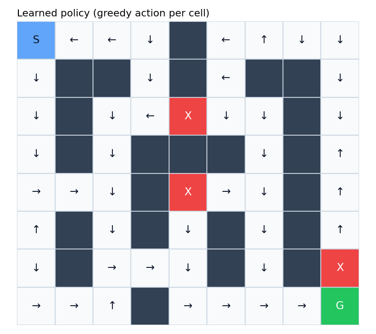
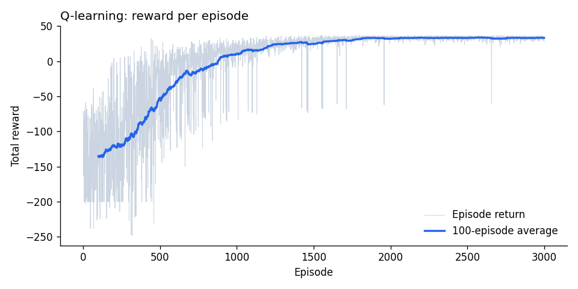
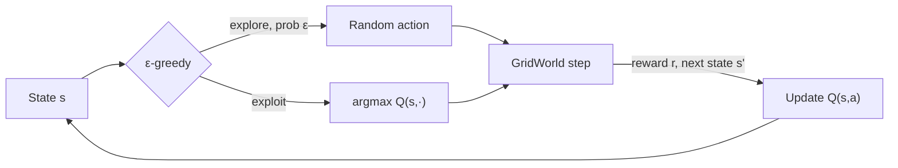

# 🎮 Q-Learning GridWorld — Reinforcement Learning from scratch

> A tabular **Q-learning** agent that learns to navigate a slippery maze, avoid pits and reach the goal — implemented from scratch in NumPy with no RL libraries.


<p>
  
  
</p>

## Overview

The agent starts at **S** and must reach **G** (+50) while avoiding pits **X** (−50, episode ends). Every step costs −1, so it learns the **shortest safe route**. The environment is **stochastic**: 10% of the time the agent "slips" and moves in a random direction, so it has to learn a policy that is robust to mistakes.

## Results

Evaluated over 500 episodes after 3,000 training episodes:

| Policy | Success rate | Avg reward | Avg steps |
|---|---|---|---|
| Random actions | 3% | −144.8 | 110.3 |
| **Q-learning agent** | **100%** | **+34.1** | **16.9** |

The learned policy (left image) takes the left and bottom corridors to reach the goal. It avoids the pit that sits directly above the goal and approaches from the side instead.

## How it works



**Q-learning update rule:**

$$Q(s,a) \leftarrow Q(s,a) + \alpha\left[r + \gamma \max_{a'} Q(s',a') - Q(s,a)\right]$$

| Hyperparameter | Value | Role |
|---|---|---|
| Learning rate α | 0.1 | How much each update moves Q |
| Discount γ | 0.95 | Values future reward (favours short paths) |
| Exploration ε | 1.0 → 0.05 (linear decay) | Explore early, exploit later |
| Episodes | 3,000 | Training budget |

## Getting started

```bash
git clone https://github.com/sanjana29-1/rl-gridworld-qlearning.git
cd rl-gridworld-qlearning
pip install -r requirements.txt
python train.py   # trains, evaluates, saves policy.png and learning_curve.png
```

Edit `DEFAULT_MAP` in `gridworld.py` to design your own maze (`S` start, `G` goal, `X` pit, `#` wall).

## Key takeaways

- **Exploration vs exploitation:** ε starts at 1.0 (pure exploration) and decays to 0.05, so the agent maps the maze first, then refines the best route.
- **Reward design shapes behaviour:** the −1 step cost is what pushes the agent towards the *shortest* safe path rather than any path.
- **Stochasticity changes the optimal route:** because of the 10% slip chance, the agent approaches the goal from the side rather than passing next to the pit.
- **Validate the environment:** a quick reachability check on the map catches an unsolvable maze before wasting training time.

## Next steps

- Compare with **SARSA** (on-policy) and **Double Q-learning**
- Move to a **Deep Q-Network (DQN)** on Gymnasium's CartPole
- Hyperparameter sweep of α, γ and the ε schedule

---
👩‍💻 **Sanjana Raj** · AI & Data graduate, Macquarie University · sanjana292001@gmail.com
